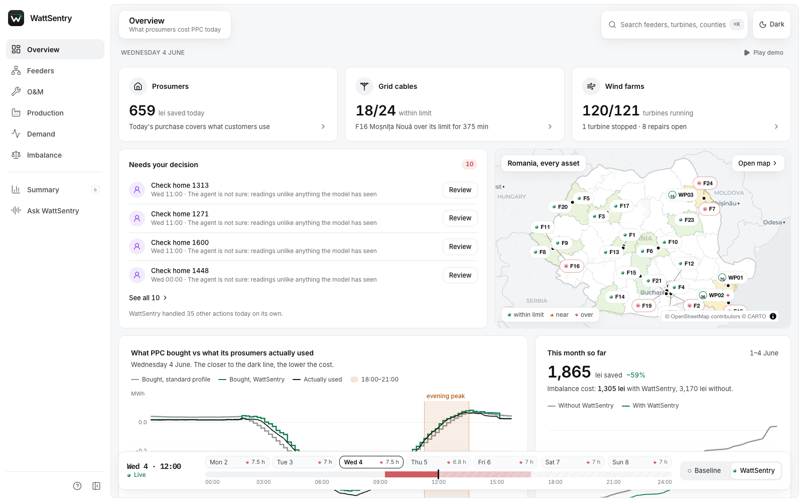
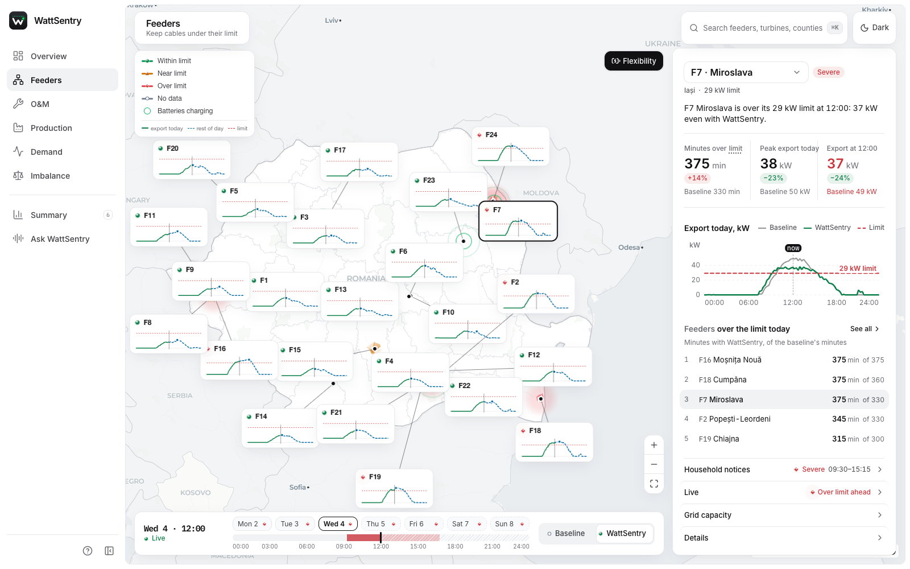
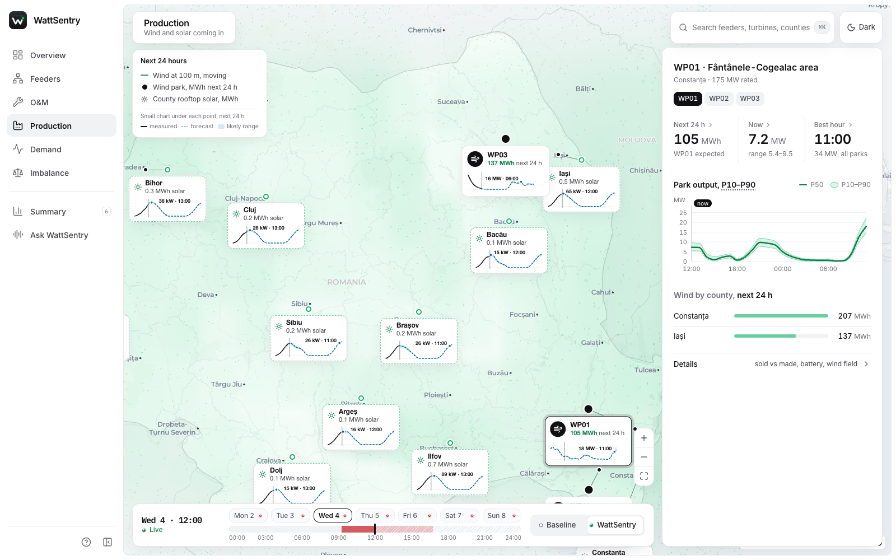
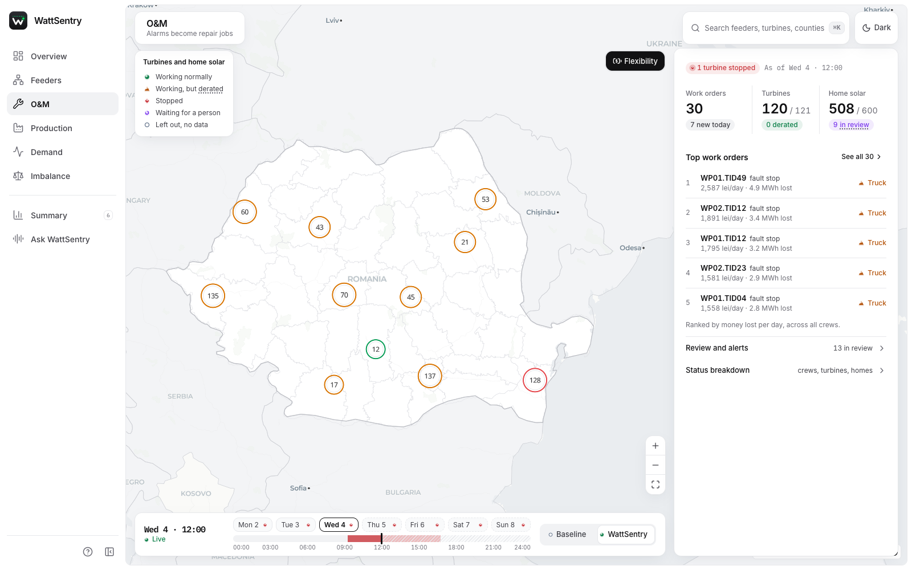
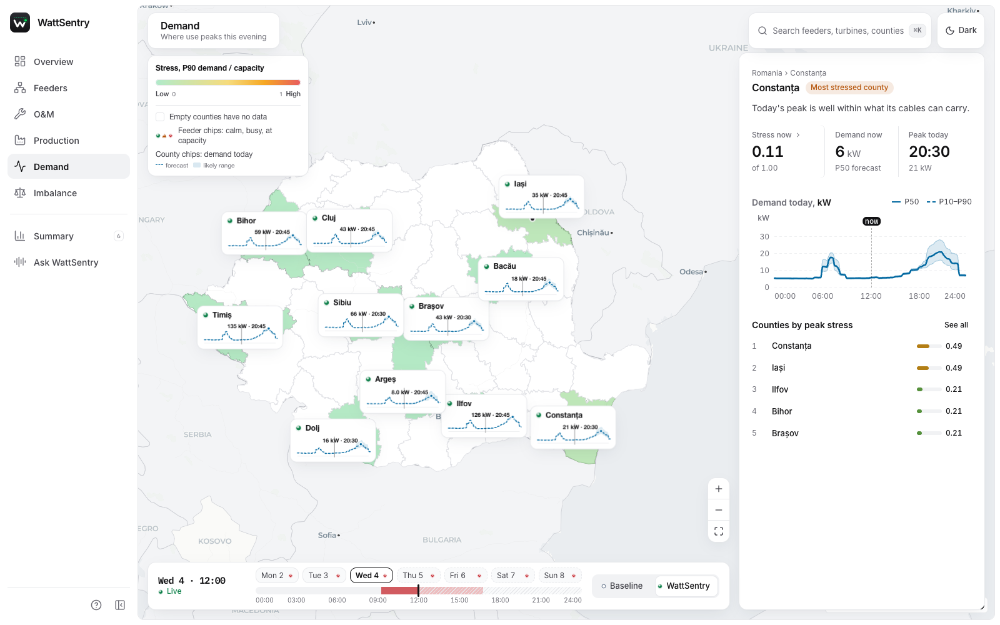

<p align="center">
  
</p>

<h1 align="center">WattSentry</h1>

<p align="center">
  Forecasting and control for distributed energy: rooftop solar, home batteries, wind farms and the low-voltage grid.
</p>

<p align="center">
  <a href="#quick-start">Quick start</a> ·
  <a href="#features">Features</a> ·
  <a href="#how-it-works">How it works</a> ·
  <a href="#models">Models</a> ·
  <a href="#development">Development</a>
</p>



WattSentry watches every prosumer site, wind turbine and feeder on one map of Romania and acts every 15 minutes.
It forecasts solar output, household load and demand with calibrated P10/P50/P90 bands, decides which assets can be
trusted, schedules home batteries so feeders stay under their export limit, and sends repair crews where they save
the most. Every decision is written to an audit log together with the prediction and model version behind it.

It was built for PPC, Romania's largest energy supplier and distributor, at Smarthack XI, and runs entirely on
open data: real Romanian weather, market prices and national load, with a simulated prosumer fleet on top.

## Features

- **Feeder limits.** A per-feeder optimiser plans home batteries a day ahead so the worst plausible midday export
  stays under the cable limit and the stored energy covers the evening peak. Customers' comfort reserve is never
  touched.
- **Committed flexibility.** Flexibility is offered to the market at its P10, computed from conformal-calibrated
  scenarios, so what is promised is what healthy assets can actually deliver.
- **Asset health.** Each site and turbine gets one status every tick: eligible, derated, excluded or human review.
  Uncertain cases go to a person instead of a truck.
- **Wind fleet monitoring.** A normal-behaviour model per turbine separates real faults from curtailment, icing and
  sensor noise, and ranks inspections by expected loss.
- **Work orders.** A daily top-K list per crew type, scored by lost energy, lost flexibility and travel.
- **Demand and imbalance.** County-level peak demand forecasts, and a comparison of what the supplier bought on the
  day-ahead market against what its prosumers actually used.
- **Judge.** A second model grades every prediction against what happened and flags the ones not to trust.
- **Voice.** Optional narrated walkthrough and "Ask WattSentry" Q&A over the current view (ElevenLabs).

| | |
|---|---|
|  |  |
| **Feeders**: export vs. limit for every feeder, with and without WattSentry | **Production**: live wind field, park forecasts and rooftop solar by county |
|  |  |
| **O&M**: site and turbine status, alerts, work orders and the review queue | **Demand**: peak stress per county with forecast bands |

## Quick start

Requirements: Node.js 22+, and for the Python side Python 3.12 with [uv](https://docs.astral.sh/uv/).

```bash
git clone https://github.com/Andrei9383/smarthack.git wattsentry
cd wattsentry
npm ci
npm run build
npm start                 # http://localhost:3000
```

The app ships with a recorded replay week (`demo/wattsentry.sqlite`), so it works offline and needs no Python.
Each mode has its own URL, e.g. `/?mode=feeders`.

To run the Python pipeline (simulator, models, replay):

```bash
make setup                # .venv with Python 3.12 and requirements.txt
make test                 # pytest
make replay               # quick end-to-end replay on a small mock world
make reproduce            # every step from raw data to the demo database, ~10 min on a laptop
```

`make help` lists all targets. All raw inputs are committed under `data/raw/`, so everything after the first
`pip install` runs offline.

## How it works

Every 15 minutes the agent runs one tick:

```
perceive ──► estimate ──► qualify ──► decide ──► act ──► log
telemetry    PV, load,    status per   per-feeder  battery     audit row per
weather      site health, asset        LP + P10    schedules,  action: model,
prices       wind, demand              commitment  work orders input hash,
                                                   alerts      prediction
```

- **Estimate.** Every model returns the same prediction envelope: quantiles, fault probabilities, an
  out-of-distribution score and ensemble spread.
- **Qualify** (`wattsentry/agent/qualify.py`). Stale telemetry excludes an asset. A wide interval, ensemble
  disagreement or unfamiliar input sends it to human review. A confident fault derates it. Thresholds are tuned on
  the validation year and frozen in `models/thresholds.json`.
- **Decide** (`wattsentry/opt/lp.py`). A linear program (cvxpy + HiGHS) per feeder keeps P90 solar minus P10 load
  under the limit, respects each battery's comfort reserve and shaves the 17:00–22:00 import peak.
- **Commit** (`wattsentry/opt/commit.py`). About 200 calibrated scenarios per feeder-day give the deliverable
  flexibility; the committed amount is its P10 minus a haircut.
- **Act and log** (`wattsentry/agent/`). Schedules, commitments, work orders and alerts go to SQLite, which the web
  app reads. The app never runs Python: every panel is precomputed by `replay.py`.

## Models

All models are trained from scratch in this repository and served with onnxruntime. Each one has a simple fallback,
so a missing model degrades a panel rather than the app.

| Model | Question | Approach | Fallback |
|---|---|---|---|
| PVNet | What should this PV system produce? | Patch transformer on weather, solar geometry and the site's own history; 4-seed ensemble | LightGBM quantiles |
| LoadNet | What will this household consume? | Same encoder, separate weights | Persistence |
| SiteHealth | Is this prosumer site healthy? | 1D-CNN on forecast residuals and telemetry, 8 fault classes | Threshold + CUSUM |
| WindNBM | Is this turbine behaving normally? | GRU normal-behaviour model + LightGBM on residuals | Rule set |
| WindPower | What will each park produce? | Probabilistic power-curve model, P10/P50/P90 | Binned power curve |
| WindFailure | Will a component fail soon? | LightGBM on daily normal-behaviour residuals | Residual trend |
| DemandNet | Where and when will demand peak? | LightGBM quantiles per county | Persistence |
| GridTwin | Is the GIS feeder/phase mapping right? | Voltage correlation + spectral clustering | GIS as recorded |
| Judge | Can this prediction be trusted? | LightGBM detectors trained on replayed outcomes | Static priors |

Trained weights live in `models/`. Training entry point: `python train.py --model <name>` (needs
`requirements-train.txt` for torch). Evaluation against every baseline on the 2025 test year: `make eval`.

### Results (2025 test year)

| | WattSentry | Baseline |
|---|---|---|
| Minutes over feeder export limit, demo week | **1,905** | 6,645 (self-consumption rule) |
| Energy over the limit | **94.5 kWh** | 1,397 kWh |
| P10 commitment hit rate | **92.0 %** | – |
| PV forecast nMAE, seen / unseen sites | **0.015 / 0.036** | 0.041 / 0.045 (LightGBM), 0.083 / 0.093 (pvlib) |
| Site fault detection PR-AUC, seen / unseen | **0.73 / 0.56** | 0.49 / 0.40 (threshold + CUSUM) |
| Wind anomaly precision / recall | **0.92 / 0.89** | 0.84 / 0.75 (rules) |
| National demand, day ahead (real data) | **nMAE 0.039** | 0.067 (persistence) |

Feeder, PV, fault and wind figures come from the simulated fleet driven by real Romanian weather; the simulator uses
pvlib physics, so the pvlib comparison flatters the model. On four real US PV systems (NREL PVDAQ) the gain over
pvlib drops to 14 %. National demand is measured on real Romanian load.

## Project layout

```
apps/web/            Next.js app: map, modes, panels, voice
packages/
  api/               oRPC routers the app calls
  db/                Drizzle schema of the replay database
  ui/                shared UI components and styles
  auth/              better-auth setup
  config/            shared TypeScript config
wattsentry/          Python package
  agent/             tick loop, qualification, triage, replay, audit log
  opt/               feeder LP, baseline policies, P10 commitment
  model/             PVNet, LoadNet, SiteHealth, wind models, battery behaviour
  judge/             prediction grading and trust models
  sim/               prosumer fleet, fault injection, wind parks
  data/              loaders and downloaders for data/raw
  eval/              baselines, metrics, uncertainty, imbalance replay
  demand/  gridtwin/ live/  contracts/  kernels/  infra/
rust/                optional Rust versions of the hot kernels
train.py eval.py replay.py
data/raw/            committed raw inputs (Parquet, GeoJSON)
models/              trained weights, calibration and thresholds
demo/                replay databases and grid results the app reads
scripts/             dataset builders, demo database tools, live feed
tests/               pytest suite
```

## Development

```bash
npm run dev               # app with hot reload
npm test                  # TypeScript type checks across the workspace
make test                 # Python tests
sh rust/build.sh build    # optional: build the Rust kernels (Python stays the reference)
```

The app picks its database in this order: `DATABASE_URL`, `demo/wattsentry.sqlite`, `demo/fixtures.sqlite`
(generate with `make fixtures`), then an empty in-memory database. Copy `.env.example` to `.env` for the optional
settings (voice key, live feed path).

## Data

| Source | Used for | Licence |
|---|---|---|
| [Open-Meteo](https://open-meteo.com/en/docs/historical-weather-api) (ERA5 / ERA5-Land), 2022–2025 | weather for 33 localities, 3 wind parks and a 0.5° grid over Romania | CC BY 4.0 |
| [Energy-Charts](https://api.energy-charts.info) (Fraunhofer ISE, ENTSO-E) | national load, generation, installed capacity | CC BY 4.0 |
| [OPCOM](https://www.opcom.ro) | day-ahead and intraday prices | public market data |
| [OpenStreetMap](https://www.openstreetmap.org) | wind turbine positions | ODbL 1.0 |
| [geoBoundaries](https://www.geoboundaries.org) | county and country outlines | CC BY 4.0 |
| [NREL PVDAQ](https://data.openei.org/submissions/4568) | real PV systems, validation only | CC BY 4.0 |

Prosumers and households are synthetic and contain no personal data. `python -m wattsentry.data.download`
re-downloads the raw inputs.

## Acknowledgements

The wind side builds on [WindMon](https://github.com/Andrei9383/Windmon) (PPC HackITall 2026): its SCADA naming,
quality rules and anomaly rules serve as the wind baseline.

Built by Andrei, Stefan, Tudor, Alexandra and yolooo332.
